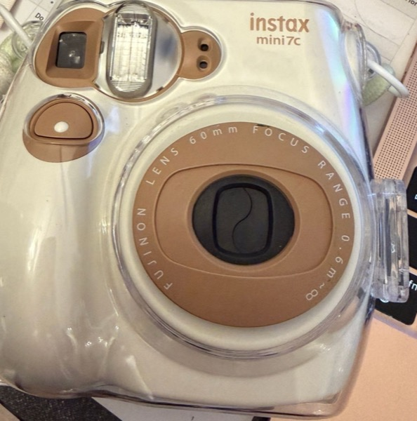

# Modeling an Instant Camera (Instax mini 7c)

A rough interactive model of my Fujifilm Instax mini 7c instant camera, built with plain HTML, CSS and JavaScript (no frameworks). The point is the **logic**: which states the camera can be in, and which actions move it from one state to another.

## How to run
Download or clone the repo and open `index.html` in any browser. No install needed.

## What it models
| Variable | Meaning |
|---|---|
| `isOn` | lens retracted (off) / extended (on) |
| `flashReady` | the flash needs ~2 s to charge after power-on and after every shot |
| `doorOpen` | back door open or closed |
| `hasFilmPack` | is a cartridge loaded |
| `darkSlideIn` | a new pack starts with a black cover sheet that ejects on the first press |
| `filmCount` | shots left (10 per pack) |
| `dialSetting` | brightness dial, 5 steps like the mini 7c: Indoor / Cloudy / Shade / Sunny / Very sunny |
| `sceneLight` | how bright the real world is (an input from the environment, not the camera) |
| `isEjecting` | a print is coming out, so input is ignored |

**Inputs:** power button, shutter button, brightness dial (`<select>`), scene picker (`<select>`), back-door button, load-film button.

**Key rules (control flow):**
- Shutter does nothing unless the lens is out, the door is closed, there's film, and the flash is charged. These are checked in an `if / else if` chain.
- The first press after loading a pack ejects the dark slide, not a photo. The counter shows `S` until then.
- Opening the door with unused film exposes it to light, so `filmCount` drops to 0.
- Exposure = `sceneLight - dialSetting`. 0 gives a balanced print, a positive number overexposes it, a negative number underexposes it. Each print "develops" over 6 seconds into its final brightness.

The **State inspector** panel shows the live variables, and the **Event log** records every transition.

## AI tools used
Claude Code (Claude Opus) — see the write-up for the prompts and my reflection.
